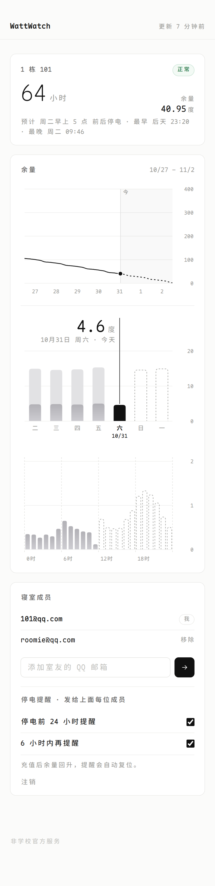

# WattWatch

> 宿舍电费余量追踪 · 懂作息的停电预测 · 停电前邮件提醒全寝室
>
> 面向全校同学：QQ 邮箱验证码登录 → 选寝室（每间最多 4 人）→ 看板 + 预警。全部跑在 Cloudflare 免费额度内。
>
> 这是一个可自部署的模板：仓库里没有任何部署实例的配置（域名、D1、邮箱、密钥都在自己的 `wrangler.local.toml` / secrets / 本机 `config.json` 里），照「部署」一节填自己的值即可。



## 功能

- **登录**：QQ 邮箱 + 6 位验证码，首次登录即注册；支持换绑邮箱、注销账号。
- **寝室**：按 校区 → 楼栋 → 房间 选择，每间最多 4 人。没有邀请码，也没有「寝室长」——寝室里人人平等，任何成员都能按 QQ 邮箱加人、移除成员、改提醒；可换寝室、退出。被加的人不用先注册就会收到提醒，之后用那个邮箱登录就直接看到寝室。
- **预测**：分别学习「工作日 / 休息日 × 24 小时」的用电画像，再用近两天的实际用电修正整体水平，逐小时模拟到余量耗尽，给出「预计 周四凌晨 2 点前后停电，最早 周三 22:00」。
- **预警**：按「最早可能停电」时刻判断——不足 24 小时发预警、不足 6 小时发临停提醒，发给寝室全部成员；充值后自动复位。读数中断时按模型继续推算，照常预警。每封邮件带一键退订（QQ 邮箱会显示「退订」按钮）。
- **记录**：自动识别充值（余量回升）、本月用电；配置电价后折算成钱。
- **看板**：**概况**（还有多久停电、余量，停电时刻给「最早 / 最晚」区间）＋ 一张长卡片里的三张图，共用同一个 7 天窗口：今天在第 5 列，右侧两天留给预测，滑动任意一张，另外两张跟着到同一周。**余量**（曲线，拖动时连续跟手、松手吸附到整周，纵轴刻度全程固定；往后是模型预测一直画到停电那天）、**用电**（参照 iOS 电池：周竖线图，浅色是全天、深色是截至此刻、虚线框是预测，点选某天；下面是选中那天的 24 小时竖线，左右滑动换天——今天剩余的时段与未来两天同样是虚线预测。**数据不完整的天**（入驻首日、中途断采）不画柱，点开只显示已覆盖的时段并标注「数据不完整」；刚加入、还没有逐小时数据时，先按全校平均画像画一条估算）、**成员**（4 个邮箱 + 加人 / 移除 + 提醒开关）。算法不外显，只在预测曲线里体现。

## 架构

```
┌──────────────────────┐  GET  待读寝室     ┌─────────────────────────────────────────┐
│ 本机轮询器 poller.py │ ◄──────────────── │ Cloudflare Worker                       │
│  cron 每小时 :20     │  POST 读数         │  ├─ Static Assets  前端（不计调用次数）  │
│  · 只读有成员的寝室  │ ────────────────► │  ├─ /api/*         登录、寝室、读数      │
│  · 每周同步寝室目录  │                    │  ├─ D1             用户/寝室/读数/模型   │
└─────────┬────────────┘                    │  ├─ 入库即增量学习 + 判定预警            │
          │ 校园卡接口                       │  ├─ SMTP（QQ 邮箱）验证码与预警邮件      │
          ▼                                 │  └─ Cron 每 30 分钟：补发邮件、掉线告警   │
   api.etslink.net                          └─────────────────────────────────────────┘
```

为什么读表放在本机而不是 Worker：学校接口在国内网络下验证可用；本机 IP 固定、没有 Worker 单次 50 个子请求的限制；Worker 只做轻量的存储与计算，不会产生额外费用。

## 预测是怎么做的

旧版用「48 小时首尾余量差 ÷ 时长」线性外推，学生作息下误差很大（白天上课几乎不用电，晚上空调/电脑集中用电）。新版在 `worker/public/js/model.js`，Worker 与前端共用：

1. **对齐计量小时**：学校后台在整点后几分钟**一次性结算**并刷新读数（实测 2026-10-10 两次刷新分别落在 :02:34 前和 :03:34 前，即 **:02~:04 之间，且不固定到某一分钟**）。所以读表只在每小时 **:10~:58** 之间进行（轮询器强制起点 ≥:10、终点 :58），留足余量避开刷新窗口。**读表时刻不是「每寝室固定」**：寝室数量变化时，各寝室在本小时内的读表时刻会整体平移，但始终落在 :10~:58（也取消了随机抖动——抖动会让采样随机落在刷新前后，造成「这小时 0、下小时翻倍」）。读数时刻减去 `METER_LAG_MIN`（默认 10 分钟）向下取整，就是它代表的整点。
2. **逐小时用电**：相邻两个计量小时的余量差就是这一小时的用电；漏采时按当前画像的形状分摊；余量上升识别为充值，不参与学习。
3. **画像**：48 个分桶（工作日 / 休息日 × 0~23 时），指数衰减加权平均，半衰期 14 天。数据少时分层收缩到「同一小时均值 × 该日类型整体倍率」→ 寝室整体水平 → **全校平均画像**（每天由已有 1 天以上数据的寝室汇总；不足 3 间时用模型内置的兜底作息形状）。所以新寝室拿到第一条读数就有粗估（标注「粗估」），一两周后作息差异逐渐显现。
4. **近期修正**：近 48 小时实际用电 ÷ 画像预期，得到 0.5~2 的倍率（例如天冷开始用暖风机）。
5. **模拟**：从最新读数开始逐小时扣减，余量到 `CUTOFF_KWH` 即为停电时刻；同时按误差带算出「最早 / 最晚」，预警按最早时刻判断。
6. **精度闭环**：每 3 小时记一次「未来 6h / 24h 预计用电」快照，到期后和实际用电比，得到 ln(实际/预测)。
   - 每个寝室：滚动统计偏差与离散度，用来修正中位预测并给出 80% 区间（「最早 / 最晚」）；评估不足 8 次时用全校的，再不足用经验值 ×1.25 / ×0.8。
   - 全校：按天累计到 `accuracy` 表，管理员在管理后台（总览页）里能看到每天 6h / 24h 平均误差的变化，用来判断改算法是变好还是变坏。

在合成的学生作息数据上（`npm test`），新模型停电时刻误差约 0.4 小时，旧线性外推约 23 小时；每小时用电带 ±40% 随机波动时，24h 预测平均误差约 7%。

法定节假日与调休可通过 `HOLIDAYS` / `WORKDAYS` 配置；寒暑假寝室无人时，近期修正会自动把预测拉长。

## 部署

需要：Cloudflare 账号（**Workers Free 计划**）、一个托管在 Cloudflare 的域名（推荐，`*.workers.dev` 在部分校园网不可达）、一个用来发信的 QQ 邮箱、一台常开的 Linux 机器（Python 3.10+）。

### 1. Worker

```bash
cd worker
npm install
npx wrangler d1 create wattwatch                       # 把输出的 database_id 填进 wrangler.toml
npx wrangler d1 migrations apply wattwatch --remote
```

编辑 `wrangler.toml`（或复制成 `wrangler.local.toml` 存放真实配置，已被 git 忽略）：

- `routes`：挂自建域名；`SITE_URL` 填同一地址（邮件里的链接）
- `ADMIN_EMAILS`：你的邮箱，接收轮询器故障通知，登录后在看板底部的「管理后台」（`/#/admin`）里看全站数据
- `SMTP_USER` / `MAIL_FROM`：发信 QQ 邮箱
- `TURNSTILE_SITE_KEY`：可选，见下

配置密钥（不会出现在代码里）：

```bash
openssl rand -base64 32 | npx wrangler secret put POLLER_TOKEN   # 同时保存一份到本机，见第 2 步
openssl rand -base64 32 | npx wrangler secret put OTP_PEPPER
npx wrangler secret put SMTP_PASS          # QQ 邮箱「设置 → 账户 → 开启 SMTP 服务」生成的授权码
npx wrangler secret put TURNSTILE_SECRET   # 可选
npx wrangler deploy                        # 或 npx wrangler deploy -c wrangler.local.toml
```

> **发信邮箱建议单独注册一个**，不要用个人主邮箱：QQ 邮箱对短时间大量发信会风控。`OTP_DAILY_CAP`（默认 300/天）限制了验证码总量。

**Turnstile（强烈建议）**：Cloudflare 控制台 → Turnstile → 添加站点（免费），把 Site Key 填进 `TURNSTILE_SITE_KEY`、Secret 用 `wrangler secret put TURNSTILE_SECRET`。启用后，发验证码前必须通过人机验证，脚本无法批量刷你的发信额度。

**WAF 限速规则（建议）**：域名 → 安全性 → WAF → 速率限制规则（免费计划含 1 条）：路径包含 `/api/`，每 IP 每 10 秒超过 30 次则阻止 10 秒。

### 2. 本机轮询器

```bash
sh scripts/install.sh
$EDITOR ~/.config/wattwatch/config.json        # 填 worker_url
printf '%s' '<与 POLLER_TOKEN 相同>' > ~/.config/wattwatch/poller_token
printf '%s' '<校园卡 token>'          > ~/.config/wattwatch/token   # 用自己的校园卡客户端抓一次包拿到
# 首次抓包时顺手把 encrypt_code 存成种子，之后 token 失效会自动续期
$EDITOR ~/.config/wattwatch/refresh.json       # 格式见 monitor/token_refresh.py
wattwatch-poll --sync-dir                      # 首次同步全校寝室目录（几十秒）
```

cron：每小时 :10 启动全量读表，在 :58 前匀速读完；每 2 分钟补读刚加入、还没有任何读数的寝室（新用户选好寝室后一两分钟内就能看到首个读数与「粗估」预测）；每周一 04:40 同步目录。

### 读表与学校接口

- 目录（购电项 → 校区 → 楼栋 → 房间）走同一个接口，一次 `--sync-dir` 就能同步完；本项目实测约 8000 间寝室、几十次请求。
- **只读有注册成员的寝室**，每间每小时 1 次请求（目录 id 缓存在 Worker，不重复查询楼栋/房间列表）。
- 请求在一小时内匀速分布、不并发，相邻两次至少间隔 `request_interval`（默认 0.5 秒）；连续 `max_consecutive_errors` 个寝室失败就停止本轮。
- 如果本机开着全局代理 / TUN，`api.etslink.net` 必须绕过代理直连：学校接口会拒绝境外出口，表现为 TLS 握手 `unexpected eof`，不是 token 过期。`mode: global` 下分流规则不生效，要在全局 Merge 里同时配 TUN 路由排除与 fake-ip 白名单，缺一不可：

```yaml
tun:
  route-exclude-address:
    - 121.237.182.255/32
dns:
  fake-ip-filter:
    - "+.etslink.net"
```

  （`api.etslink.net` 目前只有一个 A 记录 `121.237.182.255`；学校换 IP 时同步更新。）

### 读表出问题时

| 情况 | 会发生什么 | 你要做的 |
|---|---|---|
| token 用到第 25 天 | 管理员邮箱收到提醒（可忽略，已能自动续期） | 无需处理 |
| token 失效（code=300） | **自动续期**：用 `refresh.json` 的种子换新 token 并重试；只有续期也失败才停止本轮并上报 | 一般无需处理；种子失效时重抓一次包 |
| 本机关机 / 断网超过 3 小时 | 管理员邮件；看板提示数据中断 | 检查机器与 cron |
| 整轮 0 成功（TLS 握手失败 / 超时等） | 管理员收到「轮询失败」，邮件里是**真实错误**与成功/失败间数；不会误报 token | 按邮件排查：优先看本机出口能否直连 `api.etslink.net`，再确认学校接口是否可用 |
| 以上任何中断期间 | 网站按最后一次预测继续推算，**照常发停电预警**（邮件注明是推算） | — |
| 个别寝室读取失败 | 看板显示错误原因；新寝室 1 小时后再试 | 一般无需处理 |

### 从 v1 升级

v1 的 KV 数据不会自动迁移。`install.sh` 会清掉旧的 `wattwatch-run`、`wattwatch-web` 与对应 cron。同步目录后可导入旧历史：

```bash
wattwatch-poll --import-state ~/.local/share/wattwatch/state.json
```

导入不会发邮件。之后用自己的 QQ 邮箱登录、选择寝室即可。原先的 `TO_ADDR`、`ALERT_TOKEN`、`WEB_KEY`、KV 绑定已不再使用，可删除（`npx wrangler secret delete ALERT_TOKEN` 等）。

### 本地开发

```bash
cd worker
cat > .dev.vars <<'EOF'
POLLER_TOKEN=dev-poller-token
OTP_PEPPER=dev
MAIL_MODE=log
ADMIN_EMAILS=you@example.com
EOF
npm run db:local && npm run dev      # http://localhost:8787 ，验证码打印在终端
npm test                             # 预测模型单元测试
```

## 配置

### Worker `[vars]`

| 键 | 默认 | 说明 |
|---|---|---|
| `THRESHOLD_HOURS` | 24 | 预计最早停电不足多少小时发预警 |
| `URGENT_HOURS` | 6 | 不足多少小时发临停提醒 |
| `LOW_KWH` | 3 | 余量低于此值直接预警（不依赖预测） |
| `CUTOFF_KWH` | 0 | 余量到多少会停电（允许透支的楼可填负数） |
| `METER_LAG_MIN` | 10 | 学校后台刷新延迟（分钟）。读表窗口起点 ≥:10，实测刷新在 :02~:04，10 分钟是给刷新延迟留的余量；线上读数都落在 :10~:58，所以这个值只影响 :00~:09 的边缘读数 |
| `HOLIDAYS` / `WORKDAYS` | 空 | 按休息日算的日期 / 调休上班日，`YYYY-MM-DD` 逗号分隔 |
| `OTP_DAILY_CAP` | 300 | 全站每日验证码上限 |
| `PRICE` | 空 | 电价（元/度）：一个数，或按购电项 `{"1":0.56,"5":0.6}`；空则只显示度数 |
| `SMTP_HOST` / `SMTP_PORT` / `SMTP_SECURE` | smtp.qq.com / 465 / tls | 也可用 587 + `starttls` |

### 本机 `config.json`

| 键 | 说明 |
|---|---|
| `api_base` / `appid` | 校园卡接口参数（第三方服务，非本项目提供） |
| `item_ids` | 只同步这些购电项（`payment_id`），空数组 = 所有名字含「电」的购电项 |
| `areas` | 只同步这些校区（`area_name`），空数组 = 全部 |
| `area` | 导入 v1 历史时用来定位寝室的校区名 |
| `request_interval` | 两次请求校园卡接口的最小间隔（秒），默认 0.5 |
| `max_consecutive_errors` | 连续失败多少个寝室就停止本轮，默认 10 |
| `worker_url` | Worker 地址 |
| `token_file` / `poller_token_file` | 校园卡 token / 轮询器凭据 |
| `refresh_file` | token 续期种子（`encrypt_code`），默认 `~/.config/wattwatch/refresh.json` |
| `auto_refresh_token` | 拿到 `code=300` 时自动续期并重试一次，默认 `true` |

## 安全与访问控制

- 验证码：6 位、10 分钟有效、错 5 次作废，库里只存加盐哈希。限流：每 IP 每小时 20 次、每邮箱每分钟 1 次且每天 8 次、全站每日上限；可叠加 Turnstile。只接受 `@qq.com` / `@foxmail.com`，网站无法被用来给任意邮箱发信。
- 会话：随机 token 放在 `__Host-` 前缀、`HttpOnly; Secure; SameSite=Lax` 的 cookie 里，库里只存哈希；所有写操作校验 `Origin`；换绑邮箱后其它设备自动下线，并通知旧邮箱。
- 数据：寝室目录、读数、预测都要登录后才能访问，且只能看自己所在寝室；同寝室成员互相可见完整邮箱（要按邮箱加人 / 移除）。轮询器接口用独立的 Bearer token，常量时间比较。
- 退订：每封预警邮件带签名链接（HMAC，无需登录），并设置 `List-Unsubscribe` / `List-Unsubscribe-Post` 头。
- 页面：严格 CSP（只允许本站脚本与 Turnstile）、禁止被嵌入、无任何第三方 CDN 与统计。
- 防占坑：每间最多 4 人，满了进不去；绑定邮箱全局唯一，不能同时在两个寝室；管理员可在管理后台「寝室」页里查找并清空被占用的寝室。

## 费用与容量

只用到 Workers、Static Assets、D1、Cron、Turnstile、TCP Socket，**在 Workers Free 计划下超额度只会报错，不会扣费**。没有使用 KV、Durable Objects、R2、Queues 等可能单独计费的产品。请确认账号是 Free 计划：如果开通了 Workers Paid（$5/月），超额部分会按量计费。

> ⚠️ 踩坑记录：`rooms` 表里存的是**全校目录**（约 8400 间），而有注册成员的只有极少数。凡是按「有成员的寝室」筛选的查询，都必须写成 `WHERE r.id IN (SELECT room_id FROM users WHERE room_id IS NOT NULL)`（从 `users` 驱动、走 `users_room` 索引 + rooms 主键点查），**不能**写成 `FROM rooms r WHERE EXISTS (...)`——后者会全表扫描 8400 行。曾经因为轮询器取寝室接口每天被调 700+ 次，全表扫描把 D1 读额度打到 683 万行/天（上限 500 万）。

实测与估算（R = 已注册寝室数）：

| 资源 | 免费额度 | 用量 | 能支撑 |
|---|---|---|---|
| D1 写入 | 10 万行/天 | 每寝室每小时 1 行 + 每天 1 行归档 ≈ 25 行/天 | **约 3900 间**（全校 46%） |
| D1 存储 | 单库 500 MB | 112 字节/寝室·天 | 3900 间可存约 3 年 |
| D1 读取 | 500 万行/天 | 轮询取寝室 24R + 兜底推算 48R + 入库约 24R ≈ 100R 行/天；打开看板约 40 行 | 约 4 万间 |
| Worker 请求 | 10 万次/天 | 轮询器约 R×24÷25 次；每位用户每次打开 3 次 | 远够 |
| Worker CPU | 10 ms/次 | 入库每寝室约 0.1 ms，每批最多 25 间 | 留有余量 |

真正先到上限的可能是**发信邮箱**：QQ 邮箱对每日发信量有未公开的风控。粗估每个寝室每月 2~4 次预警 × 成员数；几百个寝室时建议准备两个发信邮箱，或改用自有域名邮箱。若注册寝室超过 3900 间，开 Workers Paid（含每月 5000 万行 D1 写入）即可。

## 目录

```
worker/
  src/            index.js(路由) api.js(用户接口) auth.js(验证码/会话) poller.js(轮询器接口/入库/预警)
                  mail.js(SMTP/邮件模板) cron.js(定时任务) util.js
  public/         index.html  css/app.css  js/app.js(页面) js/charts.js(SVG 图表) js/model.js(预测模型，前后端共用)
  migrations/     D1 表结构
  test/           模型单元测试
monitor/          api.py(校园卡接口) poller.py(轮询器)
scripts/          install.sh(安装) preview-demo.mjs(合成数据本地预览)
docs/             看板截图
```

## 免责声明

本项目通过第三方接口读取电表余量，**不是学校官方服务**，与接口提供方无关。轮询器使用运营者自己的凭证，只读取用户自己选择的寝室，请保持低频读取、不要扩大请求范围。此类用法可能违反相关服务条款，部署与运营者需自行评估并承担风险；请只在自己的账号/寝室上使用。
